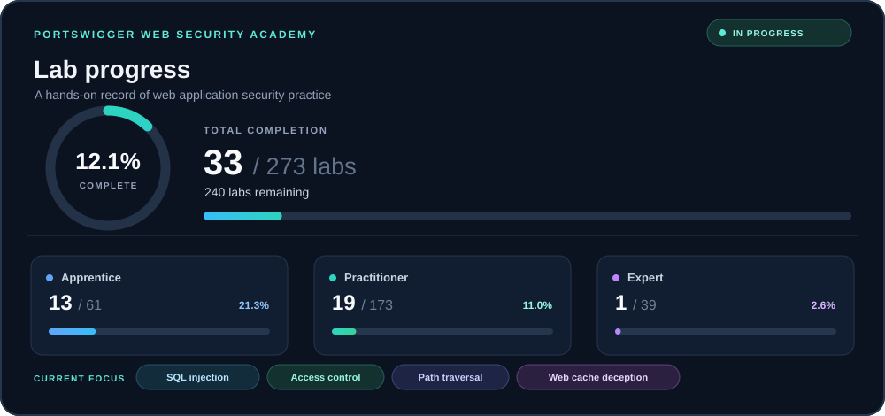

# PortSwigger Web Security Academy Labs

**A practical, continuously evolving record of web application security learning and hands-on research.**

This repository documents my progress through [PortSwigger Web Security Academy](https://portswigger.net/web-security). It focuses on understanding how web vulnerabilities work through authorized lab exercises, systematic testing, technical analysis, and clear documentation.

I study **Network Infrastructure and Cybersecurity at Jönköping University, Sweden**. I use these labs to strengthen my practical understanding of web application security and build a methodical approach to investigating vulnerabilities.

**Connect:** [LinkedIn — Matin Sadeghi](https://www.linkedin.com/in/matin-sadeghi-863487321/)

## Progress dashboard

<p align="center">
  
</p>

Current snapshot: **33 of 273 labs completed (12.1%)**. These figures reflect my current Academy tracker and are maintained manually in [`PROGRESS.md`](PROGRESS.md). The SVG is a visual snapshot, so update it and the progress file when the counts change.

| Difficulty | Completed | Total | Completion |
|---|---:|---:|---:|
| Apprentice | 13 | 61 | 21.3% |
| Practitioner | 19 | 173 | 11.0% |
| Expert | 1 | 39 | 2.6% |
| **Overall** | **33** | **273** | **12.1%** |

**Current focus areas:** SQL injection, access control, path traversal, and web cache deception.

## Objectives

- Develop practical web application security skills through hands-on labs.
- Understand the mechanisms behind common web vulnerabilities rather than memorizing payloads.
- Document investigation methods, relevant HTTP requests, test inputs, and evidence.
- Analyze root causes and identify suitable remediation strategies.
- Track progress and identify topics that need further practice.
- Build a technical portfolio that demonstrates reasoning, reproducibility, and continuous improvement.

## Topics

My learning covers web application vulnerabilities and security concepts, including:

- SQL injection
- Access control and insecure direct object references (IDOR)
- Authentication and session management
- Path traversal
- Web cache deception
- Cross-site scripting (XSS)
- Server-side request forgery (SSRF)
- Cross-site request forgery (CSRF)
- File upload vulnerabilities
- Business logic vulnerabilities
- API security

These are learning areas, not a claim that I have completed labs in every topic. The progress dashboard and [`PROGRESS.md`](PROGRESS.md) provide the current completion snapshot.

## Methodology

The goal is to understand **why a vulnerability exists, how to identify it, what impact it can have, and how to prevent it**—not simply to reproduce a successful payload.

Where relevant, each lab report will cover:

- **Objective and hypothesis:** What the lab tests and what behavior I expect to observe.
- **Investigation:** Relevant endpoints, parameters, requests, responses, and hypotheses.
- **Testing and exploitation:** The steps used in the authorized lab, with sanitized requests and relevant payloads.
- **Evidence:** Minimal evidence that demonstrates the observed behavior.
- **Root cause:** The underlying application or design weakness.
- **Remediation:** Practical measures that would prevent or reduce the vulnerability.
- **Lessons learned:** What worked, what did not, and what I would investigate next.

Reports will distinguish between labs solved independently and those completed with hints or external assistance. The aim is to document the learning process honestly and make each write-up reproducible.

## Tools and environment

Tools used in my practical work may include:

- **Kali Linux** — security testing environment.
- **Burp Suite** — HTTP interception, request analysis, and manual testing.
- **sqlmap** — automated SQL injection testing in authorized lab environments.
- **curl** — command-line HTTP requests and reproducible tests.
- **Linux command-line tools** — request inspection, text processing, and supporting tasks.

The tools actually used for each lab will be recorded in its report where relevant.

## Repository structure

```text
portswigger-web-security-labs/
├── README.md
├── PROGRESS.md
├── CATEGORY_TAXONOMY.md
├── LAB_TEMPLATE.md
├── METHODOLOGY.md
├── TOOLS.md
├── assets/
│   └── progress-dashboard.svg
├── data/
│   └── labs.json
├── labs/
│   └── README.md
└── scripts/
    └── progress.py
```

Lab reports are intended to be organized by vulnerability category as the repository grows. Supporting data and scripts may evolve alongside the reporting workflow.

## Scope and ethics

All practical testing documented here is intended for PortSwigger Web Security Academy labs and other explicitly authorized environments. Do not use the techniques documented here against systems without permission.

This is an educational portfolio documenting my personal learning. It does not represent professional penetration-testing experience, and describing a technique does not imply it has been tested against real-world systems.

PortSwigger's original learning materials remain available through the official Academy. This repository focuses on my own investigations, observations, explanations, and lessons learned.

## References

- [PortSwigger Web Security Academy](https://portswigger.net/web-security)
- [PortSwigger Web Security Academy — All Topics](https://portswigger.net/web-security/all-topics)
- [OWASP Web Security Testing Guide](https://owasp.org/www-project-web-security-testing-guide/)
- [OWASP Cheat Sheet Series](https://cheatsheetseries.owasp.org/)

---

*Continuously maintained as part of my development in cybersecurity and web application security.*
