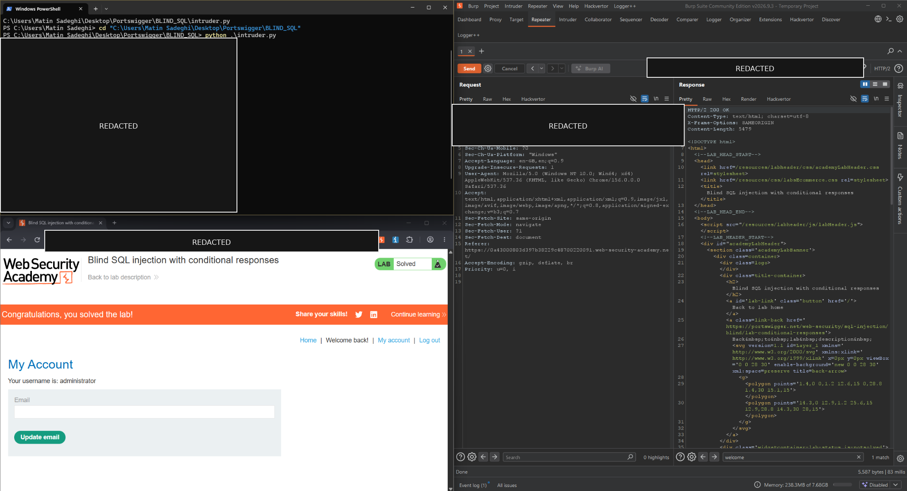
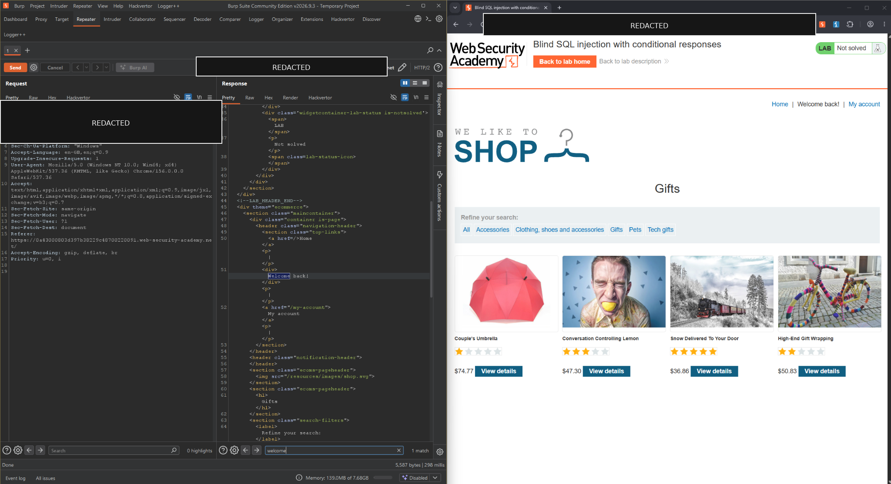

# Blind SQL Injection with Conditional Responses

[](https://portswigger.net/web-security/sql-injection/blind/lab-conditional-responses)
[](https://portswigger.net/web-security/sql-injection)
[](https://portswigger.net/web-security)

> A practical write-up documenting the investigation and successful completion of an authorized blind SQL injection training lab.

## Lab details

| Field | Details |
|---|---|
| Platform | PortSwigger Web Security Academy |
| Lab | Blind SQL injection with conditional responses |
| Difficulty | Practitioner |
| Vulnerability class | Blind SQL injection — conditional responses |
| Observable signal | Presence or absence of the `Welcome back` message |
| Tools | Burp Suite Repeater, Python, Requests |
| Status | Solved |

## 1. Objective

The application uses a `TrackingId` cookie in a database query. Query results are not directly returned and database errors are not displayed. However, the page shows a `Welcome back` message when the query returns a row.

The objective is to use this response difference to infer the `administrator` user's password and then log in as that user in the lab.

**Core concept:** even when the query result is hidden, an application may leak information through a Boolean signal: whether a tested SQL condition causes a row to be returned.

## 2. Scope and safety

All testing documented here was performed against a PortSwigger Web Security Academy lab intended for security training. Lab hostnames and session identifiers are temporary; do not reuse them against other systems.

The live lab hostname, tracking value, session cookie, and recovered password have been excluded from this repository. Screenshots were redacted before inclusion. Session cookies should be treated as credentials and must not be committed to source control.

Use the script only against an active lab instance assigned to you or another explicitly authorized environment. The included script restricts the target hostname to a `web-security-academy.net` lab host and obtains session values at runtime rather than storing them in the file.

## 3. Initial observation

I inspected the HTTP request in Burp Suite and located the `TrackingId` cookie. Adding an apostrophe to its value caused the `Welcome back` message to disappear. This suggested that the cookie value might be reaching a SQL query, though a malformed-input response on its own would not prove SQL injection.

I then compared true and false conditions. A true condition preserved the message; a false condition removed it. This established a usable signal for testing other conditions without seeing the query's returned data.

## 4. Confirming the target data

The lab description states that the database contains a `users` table with `username` and `password` columns. The next checks are to establish whether the table has rows and whether an `administrator` user exists.

Example condition used in the cookie's SQL context to test for a row:

```sql
(SELECT 'a' FROM users LIMIT 1)='a'
```

Example condition to test for the target account:

```sql
(SELECT 'a' FROM users WHERE username='administrator')='a'
```

These are fragments of conditional test expressions, not standalone SQL statements. The required prefix, quoting, and delimiters depend on the application's query context.

## 5. Extracting the password one character at a time

The central test checks a single character of the password against a candidate character:

```sql
(SELECT SUBSTRING(password, 1, 1)
 FROM users
 WHERE username='administrator')='a'
```

What each part means:

- `users` is the table containing the user record described by the lab.
- `password` is the field whose value is being tested.
- `WHERE username='administrator'` selects the target account.
- `SUBSTRING(password, 1, 1)` returns one character starting at position 1. Changing the second argument tests a different position.
- `='a'` compares the extracted character against the current candidate.

If the comparison is true, the application returns a row and the `Welcome back` message appears. If it is false, the message disappears. Repeating this test for each character position and candidate reveals the value a character at a time.

The lab states that the password consists of lowercase alphanumeric characters and the observed password length was 20 characters. These assumptions are specific to this exercise; another application may use a different schema, SQL dialect, length, or character set.

## 6. Python automation

Manually testing every possible character through Burp Repeater would be repetitive. I used Python and the Requests library to automate the repeated HTTP requests and check whether `Welcome back` appeared in each response.

The script is included as [`intruder.py`](intruder.py). Although the filename follows my local working file, this is a Python request automation script, not the Burp Suite Intruder tool itself.

### Configuration

Install the dependency:

```powershell
python -m pip install requests
```

Set the configuration in the same PowerShell session before running the script. Replace the placeholders with values from your own active lab; do not save real values in the repository:

```powershell
$env:LAB_URL = "https://<YOUR-LAB-HOST>/"
$env:TRACKING_ID = "<ORIGINAL_TRACKING_ID>"
$env:SESSION_COOKIE = "<CURRENT_SESSION_COOKIE>"
python .\intruder.py
```

The script asks for these values if environment variables are not set. It prints extraction progress and the recovered password to the local terminal, so avoid screenshots or logs that expose the output.

With 36 possible characters (26 lowercase letters plus 10 digits), sequential testing may send up to 36 requests per position, or 720 candidate requests for a 20-character password, before accounting for retries. This is simple educational automation rather than an optimized method. Request failures, changes to the lab response, rate limits, or other defenses can interrupt it.

## 7. Result and validation

The script recovered the 20-character administrator password in the lab. I then used it to log in as `administrator`, and the Web Security Academy displayed the solved state.

The recovered password is intentionally not reproduced in this report. The evidence screenshots have also been redacted to remove session and credential data.

## 8. Technical analysis

The workflow demonstrates these stages:

1. **Identify a candidate input** — inspect the `TrackingId` cookie.
2. **Establish a Boolean signal** — compare responses for true and false conditions.
3. **Check the target record** — test for the `users` table and `administrator` user.
4. **Infer characters** — compare a one-character substring with candidate values.
5. **Automate repeated requests** — use Python Requests to test candidate characters consistently.
6. **Validate impact** — confirm that the recovered credential allows administrator login in the lab.

The important finding is the response-based inference method, not a single payload. Hidden query results can still leak data when application behavior depends on whether a condition is true or false.

## 9. Limitations and real-world considerations

- **Database differences:** SQL functions and syntax vary across database engines; the payload must fit the target DBMS and query context.
- **Unknown schema:** this lab supplies the table and column names. They may not be known in a real authorized assessment.
- **Password storage:** real applications should store salted password hashes rather than plaintext passwords. SQL injection can still expose sensitive stored values, but impact depends on what is stored and how it is protected.
- **Request volume:** sequential character-by-character extraction can be slow and generate many requests.
- **Defensive controls:** no visible blocking or CAPTCHA interrupted this lab run. That does not establish that a firewall or WAF was absent, or that this technique would work unchanged elsewhere.
- **Credential handling:** redact session cookies, tokens, host-specific identifiers, and recovered credentials from reports and screenshots.

## 10. Remediation

- Use parameterized queries or prepared statements instead of concatenating cookie values into SQL.
- Apply least-privilege permissions to application database accounts.
- Avoid unnecessary response differences that disclose query outcomes.
- Store passwords using a modern password-hashing algorithm with unique salts.
- Monitor suspicious repeated requests and unusual tracking-cookie values.
- Treat input validation and WAF rules as supplementary controls, not replacements for parameterized queries.

## 11. Evidence

### Lab solved and extraction run



### Burp Suite request and conditional response



Host-specific identifiers, cookies, and recovered credentials were redacted before publication.

## Key takeaways

- Blind SQL injection can disclose data without returning query results directly.
- A condition-dependent page message can serve as a Boolean side channel.
- `SUBSTRING` allows a value to be inferred one character at a time.
- Python can automate repeated checks, but automation increases request volume and must account for failures.
- The primary defense is to prevent untrusted input from changing SQL query structure.

## References

- [PortSwigger lab: Blind SQL injection with conditional responses](https://portswigger.net/web-security/sql-injection/blind/lab-conditional-responses)
- [PortSwigger: Blind SQL injection](https://portswigger.net/web-security/sql-injection/blind)
- [PortSwigger: SQL injection](https://portswigger.net/web-security/sql-injection)

---

*Educational work completed in an authorized training environment.*
